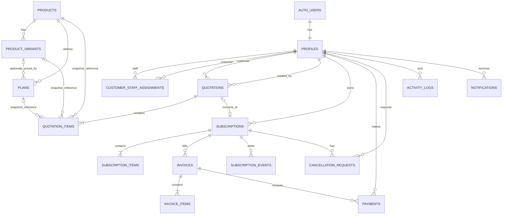

# Entity Relationship Diagram

`product`, `variant`, and `plan` references are useful traceability links, not the historical source of truth: item snapshot columns remain authoritative after catalogue changes. `invoices` has one unique period per subscription. Detailed cardinalities and constraints are in `DATABASE_DESIGN.md`.
