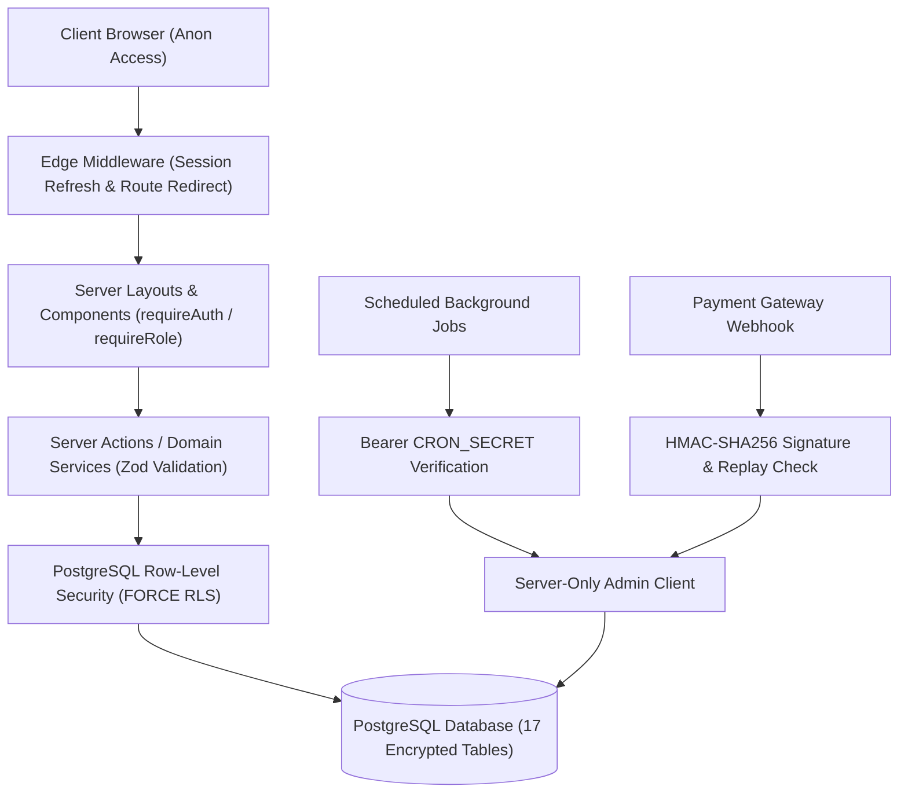

# Security Review & Threat Modeling Audit (TASK-061)

**Date:** 2026-10-31  
**Status:** Approved & Remediated  
**Owner:** Shamil (Foundation, Security, Architecture & Release Owner)

---

## 1. Threat Modeling Architecture & Boundaries

The Subscription Management System employs a multi-tiered defense-in-depth model across the Next.js App Router and Supabase PostgreSQL.

---

## 2. Threat Analysis & Remediation Matrix

### 2.1 Authentication & Credential Isolation
* **Threat:** Exposure of `SUPABASE_SERVICE_ROLE_KEY` to browser or client JavaScript bundles.
  - **Remediation:** Isolated exclusively in `src/lib/supabase/admin.ts` guarded by `import "server-only"`. Any attempt to import into client code halts build with compile-time error.
* **Threat:** Self-elevation of roles upon user registration.
  - **Remediation:** User signup action assigns only the default `customer` role. The database PostgreSQL trigger `on_auth_user_created` enforces role safety at the engine level. Staff accounts can only be provisioned through administrative invitation.

### 2.2 Server Actions & Route Handlers
* **Threat:** Direct invocation of Server Actions by unauthenticated or unauthorized users bypassing UI buttons.
  - **Remediation:** Every Server Action in `src/app/actions/` invokes `requireAuth()` or `requireRole(["admin", "staff"])` before inspecting arguments or querying the database.
* **Threat:** Malformed, boundary-breaking, or oversized inputs.
  - **Remediation:** Zod validation schemas strictly enforce UUID formats, positive numeric ranges, enum whitelisting, and string length boundaries across all inputs.

### 2.3 Row-Level Security (RLS) & Direct Database Attacks
* **Threat:** Data leakage across customer tenants or between unassigned staff accounts.
  - **Remediation:**
    - `ALTER TABLE ... FORCE ROW LEVEL SECURITY` applied across all 17 tables.
    - Customer queries restricted to `auth.uid() = customer_id`.
    - Staff queries restricted via `customer_staff_assignments` (`is_active = true`).
    - Admin override policies explicitly verified.
* **Negative Matrix Verification:**
  - Anonymous user: Rejected on all application tables.
  - Customer accessing other customer's invoices/quotes: 403 Forbidden / 0 rows returned.
  - Staff accessing unassigned customer data: Denied.
  - Inactive profile: Middleware and server authorization immediately redirect to `/login?error=account_inactive`.

### 2.4 Financial Integrity & Invariants
* **Threat:** Floating-point rounding errors causing money discrepancies.
  - **Remediation:** Quotation pricing engine uses fixed-point `BigInt` (SCALE=10000). Payment recording uses integer cents.
* **Threat:** Concurrent duplicate invoice generation for the same billing cycle.
  - **Remediation:** Database-enforced unique constraint `CONSTRAINT uq_subscription_billing_period UNIQUE (subscription_id, billing_period_start, billing_period_end)`.
* **Threat:** Retroactive mutation of issued financial documents.
  - **Remediation:** `assertInvoiceMutable` strictly blocks updates to invoices in `issued`, `paid`, `overdue`, or terminal states. `activity_logs` and `subscription_events` are append-only.

### 2.5 Webhook & Cron Job Protection
* **Threat:** Replay attacks or forged payment notifications.
  - **Remediation:**
    - HMAC SHA-256 cryptographic signature verification.
    - 5-minute timestamp tolerance window eliminates replay attacks.
    - Idempotency guard checks `payments.provider_transaction_id` and `activity_logs.entity_id`.
* **Threat:** Unauthorized browser invocation of automated billing cron route.
  - **Remediation:** `/api/billing/cron` rejects all requests missing valid `Authorization: Bearer <CRON_SECRET>`.

### 2.6 HTTP Defense Headers
Configured in `next.config.mjs`:
* `X-Frame-Options: DENY` (Anti-Clickjacking)
* `X-Content-Type-Options: nosniff` (MIME Sniffing Defense)
* `Referrer-Policy: strict-origin-when-cross-origin`
* `Strict-Transport-Security: max-age=63072000; includeSubDomains; preload` (HSTS)
* `Permissions-Policy: camera=(), microphone=(), geolocation=()`
* `X-XSS-Protection: 1; mode=block`
